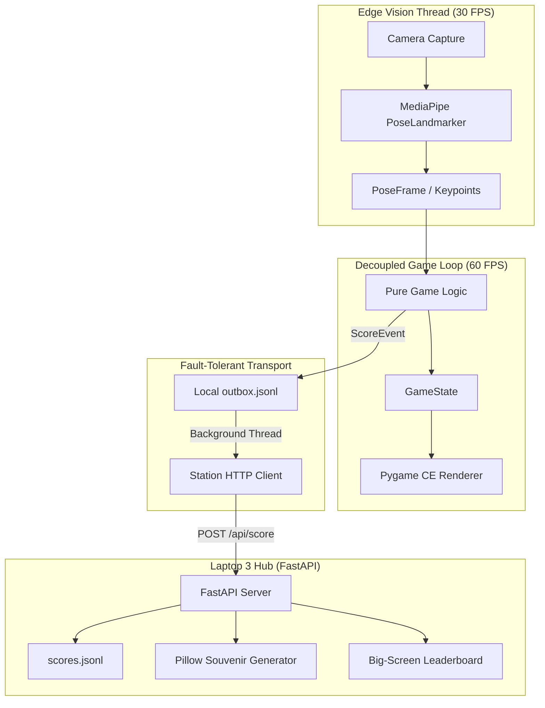

# ⚡ Titans' Arcade: Dodge & Drip

> **🏆 1st Place Winner — College Tech-Fest Showcase**  
> **Real-Time Edge Spatial Computing & Optical Motion Capture on Commodity Hardware.**  
> Zero cloud latency. Zero expensive VR/MoCap suits. 100% offline edge vision on standard laptops.

---

```
                       ┌──────────────────────────────────────────────┐
                       │          TITANS' ARCADE CLUSTER              │
                       └──────────────────────┬───────────────────────┘
                                              │
                    ┌─────────────────────────┼─────────────────────────┐
                    │  (Wi-Fi / Local Switch) │                         │
                    ▼                         ▼                         ▼
         ┌─────────────────────┐   ┌─────────────────────┐   ┌─────────────────────┐
         │      LAPTOP 1       │   │      LAPTOP 2       │   │      LAPTOP 3       │
         │  STATION A (LAVA)   │   │ STATION B (BLAZER)  │   │  FASTAPI HUB / KIOSK│
         ├─────────────────────┤   ├─────────────────────┤   ├─────────────────────┤
         │ • Planar Homography │   │ • 6-Limb Kinematics │   │ • Player Register   │
         │ • Feet Grid (10x10) │   │ • Scale Invariance  │   │ • Live Leaderboard  │
         │ • Outbox Spooler    │   │ • DDA Tolerance     │   │ • Souvenir Cards    │
         └─────────────────────┘   └─────────────────────┘   └─────────────────────┘
```

---

## 🎮 The Stations

### 🌋 Station A: Floor is Lava
- **Concept:** Players physically navigate a 1.8m × 1.8m arena divided into a 10×10 dynamic subtile grid. 
- **Computer Vision:** 
  - Monocular camera feed calibrated via a **Planar Homography Matrix ($H \in \mathbb{R}^{3 \times 3}$)** mapping image pixels $(u, v)$ directly to real-world Euclidean floor coordinates $(X_w, Y_w)$.
  - Only the player's feet touch the floor plane ($Z=0$), preventing parallax distortion from head/arm movements.
  - **1-Euro Adaptive Low-Pass Filter ($f_c = f_{\text{min}} + \beta |\hat{v}|$):** Dynamically scales cutoff frequency from $0.8\text{ Hz}$ at rest (eliminating sensor noise jitter) to $20+\text{ Hz}$ during movement, delivering sub-millimeter stability with $<15\text{ ms}$ latency and 60 FPS fluidity.
- **Game Engine:** 3-round tournament lifecycle (Rivers, Islands/Donuts, Bridges) with 30s active rounds, 7.5s resting intervals, dynamic heatmap propagation, and combo streak multipliers.

### ⚡ Station B: Pose Blazer (Speed Pose Match)
- **Concept:** Players race against the clock to match 36 high-energy pop-culture and athletic poses.
- **Computer Vision & Kinematics:**
  - Evaluates **scale-, height-, and distance-invariant interior joint angles** across 6 major limbs (shoulders, elbows, knees) using normalized vector dot products.
  - Zero-cost Edge Optical Motion Capture pipeline serving as human demonstration trajectories for Inverse Kinematics (IK) retargeting.
- **Game Engine:** 2-stage tournament (Stage 1: Precision Gauntlet, Stage 2: Speed Rush) featuring Dynamic Difficulty Adjustment (DDA), a clean 3-zone retro arcade attract screen, and a **Touch-Nose Skip Gesture** with edge-triggered latching (release-to-rearm) to eliminate false skips on overhead poses.

### 🖥️ Laptop 3: Event Core & Souvenir Studio
- **Central FastAPI Server:** Sub-millisecond REST & SSE backend coordinating station heartbeats, player queues, and high-scores.
- **Live Spectator Leaderboard:** Cyberpunk-themed 60 FPS real-time big-screen display ranking top competitors across games.
- **Souvenir Photo Cards:** High-resolution 1080×1350 souvenir cards rendered with procedural sunset arcade gradients, player photo, match telemetry, and QR code verification.
- **Fault-Tolerant Outbox:** Game stations write score events to local `outbox.jsonl` first; if the network drops, stations keep playing and auto-flush upon reconnection.

---

## 📐 System Architecture



---

## 💻 Hardware Topologies

| Topology | Configuration | Best Used For |
|---|---|---|
| **3-Laptop Stall Mode** | Laptop 1 (Station A), Laptop 2 (Station B), Laptop 3 (Server / Leaderboard / Registration Kiosk) | High-throughput college tech-fests, expos, tournaments |
| **2-Laptop Showcase Mode** | Laptop 1 (Server + Station A + Browser Leaderboard), Laptop 2 (Station B) | Classroom presentations, team demos, hackathon pitching |
| **1-Laptop Standalone Mode** | Single PC running any station with `--standalone` or local embedded mock server | Development, testing, portfolio screen recordings, web deployment |

---

## 🚀 Quickstart & Setup

### 1. Installation
Requires **Python 3.11 or 3.12**:
```bash
git clone https://github.com/AnonAjay/Dodge-Dash.git
cd Dodge-Dash
python -m venv .venv
# Windows:
.venv\Scripts\activate
# Linux/macOS:
source .venv/bin/activate

pip install -r requirements.txt
python -m tools.get_models
```

### 2. Run Laptop 3 (Central Server & Leaderboard)
```bash
uvicorn server.app:app --host 0.0.0.0 --port 8000
```
- Registration Kiosk: `http://localhost:8000/register`
- Big-Screen Leaderboard: `http://localhost:8000/leaderboard`

### 3. Run Station A (Floor is Lava)
```bash
# With connected server:
python -m station_a --server http://<SERVER_IP>:8000

# Standalone / Keyboard test:
python -m station_a --keyboard
```

### 4. Run Station B (Pose Blazer)
```bash
# With connected server:
python -m station_b --server http://<SERVER_IP>:8000

# Standalone / Keyboard test:
python -m station_b --keyboard
```

---

## 🛠️ Developer Tools

- **Pose Studio & Angle Tuner:** `python -m tools.pose_studio` (interactive visual pose editor, target angle tuning, live webcam calibration)
- **Pose Catalog Indexer:** `python -m tools.index_poses --list`
- **Floor Homography Calibrator:** `python -m tools.calibrate_floor`
- **Camera & Inference Benchmark:** `python -m tools.timing_test`
- **Unit & Integration Tests:** `pytest`

---

## 📚 Technical Research & Academic Defense

For deep technical questions regarding computer vision trade-offs, kinematics math, and interview defense, consult [learning.md](file:///d:/Projects/Helper_Repo/dodge-and-drip/learning.md):
- **Bazrev et al. (CVPR 2020):** *BlazePose: On-device Real-time Body Pose Tracking* (Single-person edge pose estimation).
- **Jiang et al. (2023):** *RTMPose: Real-Time Multi-Person Pose Estimation based on MMPose* (SimCC coordinate classification).
- **Brahmbhatt et al. (CVPR):** *ContactPose: A Dataset of Hand-Object and Foot-Surface Contact* (Explicit ground contact modeling).

---

## 📜 License & Acknowledgments
Built for the college tech-fest by the Dodge & Drip team. Powered by MediaPipe, Pygame Community Edition, and FastAPI.
